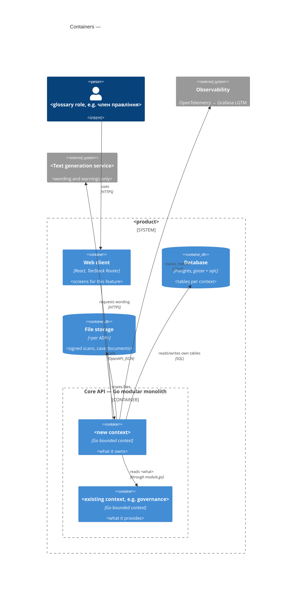

# C4 — Container (ao-architecture default)

<!-- Embedded inline in SAD §5. One Container per declared target_surface; the rest are the
     recommended containers from references/repo-practice.md §Recommended containers.
     Bounded contexts are a nested Container_Boundary inside core. Drop a container only with a
     reason in §5 prose. Syntax → references/c4-mermaid-syntax.md -->

