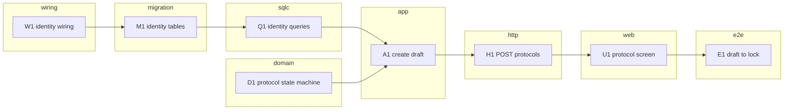

# Epic - <slug>

> **PRD:** [<prd>](../<prd>) · **Design:** [<sad>](../<sad>) · **ADRs:** [<adr_dir>](../<adr_dir>) ·
> **Data model:** [data-model](../<data-model file>) · **Contract delta:** [openapi.yaml](../<contract>/openapi.yaml) ·
> **Context:** [CONTEXT.md](../CONTEXT.md) · **Machine plan:** [tasks.json](./tasks.json) · **Status:** [tracker.md](./tracker.md)

## Goal

<!-- instruction: 2-3 sentences - what shipping Stage 1 delivers, tied to PRD §2 Goals. -->

## Scope

- **In:** Stage 1 - <US ids>; contexts <list> (new: <list>); surfaces <target_surfaces>.
- **Out:** Stage 2 ACs <ids> and their codes <codes>; PRD §3 non-goals <one line>.

## Task map

<!-- instruction: the same DAG as tasks.json, one subgraph per ao_layer in layer order, edges = deps.
Node label "<id> <short title>". Validate per ../references/shared/mermaid-check.md. Drop empty subgraphs. -->

## Tasks

| # | Task | Layer | Context | Blocked by | ACs | Est |
|---|---|---|---|---|---|---|
| W1 | <title> | wiring | <bc> | - | - | S |

## Parallel branches

<!-- instruction: name the branches that start together (e.g. domain D* alongside migrations M*;
identity alongside governance after W1) and the critical path from the checker (longest_chain). -->

## Self-check

<!-- instruction: paste the summary lines and the AC coverage table printed by
`node .claude/skills/ao-break-tasks/scripts/check-tasks.mjs docs/features/<slug> --prd <prd> --tasks <dir>/tasks.json`,
then the by-eye checks from references/self-check.md as a checklist. -->

## Risks / hard rules

<!-- instruction: PRD §6 NFR, SAD §11 risks and ADR constraints a task must not break
(org filter, no cross-context FK or import, triggers only by ADR, expand/backfill/contract). -->

## Notes

<!-- instruction: repo vs references/repo-practice.md differences; CONTEXT vs §5.1 code mismatches;
contract verdict and deferrals; anything the user decided during the run. -->
